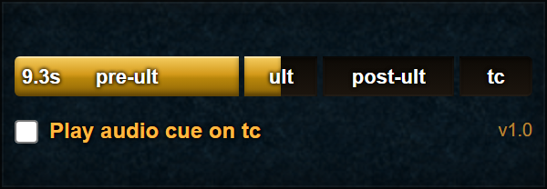

# Vorago Tag

An [Alt1 Toolkit](https://runeapps.org/alt1) overlay that helps you time your
Ultimate and target cycle (TC) for Vorago's **Grandmaster rotation in P3 and P5**.
Use it alongside the
[PVME Vorago combat achievements rotation](https://pvme.io/pvme-guides/combat-achievements/vorago-ca/).

## What it does

When Vorago's HP bar becomes empty at the end of a phase, the countdown starts
automatically. Follow the sections from left to right:

| Section    | What to do                            |
| ---------- | ------------------------------------- |
| `pre-ult`  | Get ready for your Ultimate.          |
| `ult`      | Use your Ultimate during this window. |
| `post-ult` | Continue your rotation after ulting.  |
| `tc`       | Target cycle back to Vorago.          |

The `ult` and `tc` windows count down in tenths of a second to help you time
your inputs. Tick **Play audio cue on tc** if you'd like a beep when the TC
window starts. Your choice is remembered next time you open the app.

## Install

1. Install [Alt1 Toolkit](https://runeapps.org/alt1).
2. Open [Vorago Tag](https://fletchto99.github.io/VoragoTag/) and click **Add to Alt1**.
3. Open **Vorago Tag** from your Alt1 app list while playing RuneScape.

You can also try **Start demo timer** on the website before installing.

## Good to know

- Keep Vorago's HP bar visible and allow Alt1 to read the game screen.
- The timer starts once per empty bar; you don't need to reset it manually.
- The HP bar can move, but different interface scaling may stop it being recognised.
- If the app can't read the game or play audio, it shows a message explaining what's wrong.
- **The Scopulus phase is not supported.** The timer relies on Vorago's HP bar becoming empty.

## Contributing

See [the contributor guide](CONTRIBUTING.md) for development and screenshot updates.

## Credits

Inspired by [DaStewie's original Vorago Tag app](https://runeapps.org/forums/viewtopic.php?id=1277).
